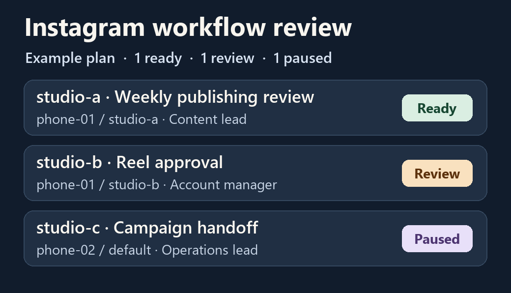

# Instagram Automation Workflow Planner


Plan Instagram automation for multiple accounts on Android. Give every workflow an account alias, device, profile, owner, and review status before anyone starts it.

This free kit from [SMTasker](https://smtasker.com/) pairs a spreadsheet-ready CSV with a local Python checker. The checker runs offline, checks the assignments, and produces a Markdown handoff your team can review. Account aliases are enough, and no login is required.

**[Try the example](#try-the-example) · [Get the CSV template](plan-template.csv) · [Set up in SMTasker](#from-the-plan-to-smtasker)**

## Try the example

1. Download this repository using **Code → Download ZIP**, then extract it.
2. Open a terminal in the extracted folder. Use Python 3.10 or later. No packages are required.
3. Run the checker with the [sample plan](example-plan.csv). The example uses fictional accounts and device labels.

```sh
python check_plan.py example-plan.csv
```



In this example, the account manager still needs to review `studio-b`'s Reel. The two workflows on `phone-01` are assigned to distinct profiles.

### Find a profile conflict before launch

Suppose someone sets `studio-b`'s profile to `studio-a` in the example CSV. Both accounts now point to the same profile on `phone-01`. The checker flags the conflict and points to the earlier row so the team can correct the assignment before sharing the plan.

```text
Line 3: another account uses this device/profile on line 2.
```

## Plan your own workflow

1. Copy [plan-template.csv](plan-template.csv) to `my-plan.csv`. Keep the six headers and add one row per account and workflow.
2. Use stable labels such as `studio-a` and `phone-01`. Use `default` if the device has one relevant profile. When an account has several workflows, keep its device and profile consistent across those rows.
3. Assign an owner and set `review` for work that needs a decision, `ready` once your team has reviewed the plan, or `paused` for work on hold.
4. Save as a UTF-8, comma-separated CSV and run `python check_plan.py my-plan.csv`. Use `--output review.md` to save the report to a new file.

The checker flags missing fields, unrecognized statuses, repeated account and workflow pairs, and device/profile assignment conflicts. A successful check means the CSV passes those rules. Review the assignments in the actual product before starting.

## From the plan to SMTasker

SMTasker runs supported Instagram automations on connected Android devices. Use the report as a handoff while you configure the workflow in SMTasker.

1. Confirm the accounts and device profiles, then choose the accounts and actions in Workflows.
2. Set the working times and limits for the workflow. Review the configuration and save a draft if someone still needs to sign off.
3. After a workflow runs, check **Results** for individual actions and **Activity Log** for what happened and when.

- [Manage multiple Instagram accounts for clients](https://smtasker.com/how-to-manage-and-automate-multiple-instagram-accounts-for-clients/)
- [Create and review a workflow in SMTasker](https://smtasker.com/knowledge-base/getting-started-with-workflows/)
